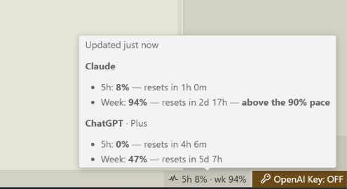

# Claude Usage Indicator

Status-bar extension for Cursor and VS Code. It shows how much of the Claude 5-hour and weekly subscription limits is used. ChatGPT plan limits can be added to the tooltip.

The package contains no tokens or API keys.

## Install

1. Download `claude-usage-indicator-0.0.9.vsix` from [Releases](https://github.com/CrocoGen/claude-usage-indicator/releases).
2. In Cursor: Extensions, then `...`, then **Install from VSIX**.
3. Reload the window.

The status bar shows `5h` and `wk`. The tooltip has the reset times.

## Same computer as Ungate

Leave the remote URL empty. The extension reads the OAuth tokens Ungate already stores in `~/.ungate/data.db` and asks Claude and ChatGPT for the limits. The built-in Ungate tunnel is not used.

ChatGPT stays hidden until **Claude Usage Indicator: Show Chat Gpt** is enabled.

## Ungate on another machine

Set **Claude Usage Indicator: Ungate Url** to a stable tunnel address, or run **Claude Usage: Configure remote Ungate**. That mode reads Claude limits from response headers and spends 1 token on each refresh. ChatGPT is still read only from a local Ungate database or `~/.codex/auth.json`.

Expired tokens are skipped. The extension does not refresh them.
